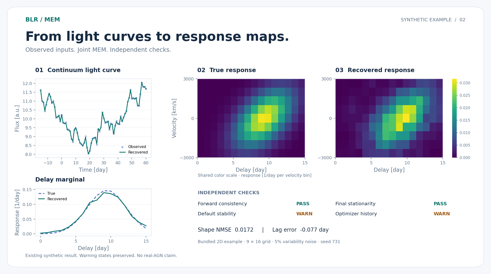

<div align="center">


<h1>BLR · MEM Workbench</h1>

<h3>从光变，重建响应。</h3>

<p>一维时延响应 · 二维速度–时延图<br>生成数据 · 最大熵反演 · 独立检测 · 离线分析</p>

<p>
  <a href="https://github.com/jianyuanliljy-hub/blr-mem-workbench/actions/workflows/ci.yml"></a>
  <a href="pyproject.toml"></a>
  <a href="#快速开始"></a>
  <a href="docs/USAGE_ZH.md"></a>
  <a href="https://github.com/jianyuanliljy-hub/blr-mem-workbench/releases/tag/v0.1.0-dev1-r1"></a>
</p>

<p>
  <a href="#快速开始">快速开始</a> ·
  <a href="https://github.com/jianyuanliljy-hub/blr-mem-workbench/releases/download/v0.1.0-dev1-r1/BLR_MEM_Workbench_0.1.0-dev1_Windows_x64.zip">Windows 下载</a> ·
  <a href="https://github.com/jianyuanliljy-hub/blr-mem-workbench/releases/download/v0.1.0-dev1-r1/BLR_MEM_Workbench_0.1.0-dev1_macOS_AppleSilicon.zip">macOS 下载</a> ·
  <a href="docs/USAGE_ZH.md">使用指南</a> ·
  <a href="#命令行">命令行</a> ·
  <a href="#验证结果">验证结果</a> ·
  <a href="CONTRIBUTING.md">参与贡献</a>
</p>

<p><b>简体中文</b> · <a href="README_EN.md">English</a></p>

</div>

BLR MEM Workbench 将活动星系核宽线区（broad-line region, BLR）的合成数据生成、最大熵法（maximum entropy method, MEM）反演和结果检查放在同一个本地工作台。Windows、Mac 成品自带运行环境，完整解压即可启动；界面和命令行共用一套计算核心。

<p align="center">
  
</p>

<p align="center"><sub>来自随包的二维合成示例，使用既有结果绘制；9 × 16 网格，5% 变异信号噪声。默认图像稳定性与优化历史警告保留。<a href="docs/assets/preview.json">图像来源与文件哈希</a></sub></p>

## 为什么用它

- **一个连贯的工作流程。** 从生成、反演到报告，自动衔接数据路径；常用参数使用带单位的表单，高级 JSON 和命令行同时保留。
- **一套实现，两种维度。** `1D/` 和 `2D/` 各自保存示例配置、MEM 默认参数与扫描网格，共用生成器、检测器和界面。
- **看得见结果，也查得到依据。** 无噪声真值与观测分开保存；独立前向检查、真值对照、残差和迭代历史一并进入离线报告。

| 你要做的事 | 程序提供什么 |
|---|---|
| 生成一例数据 | 真实连续谱、真实发射线、时延响应或速度–时延图；默认不加噪声 |
| 批量生成 | 独立随机数流、逐例身份记录、配置核对后的续跑 |
| MEM 反演 | 连续谱、背景和响应联合求解；默认配置与完整超参数扫描 |
| 独立检测 | 文件哈希、数组约定、前向一致性、最终一阶条件、默认图像稳定性 |
| 分析与分享 | 真值对照、边缘响应、残差、迭代历史、HTML 报告和逐例 CSV |

## 快速开始

从 [Release](https://github.com/jianyuanliljy-hub/blr-mem-workbench/releases/tag/v0.1.0-dev1-r1) 下载适合系统的压缩包，**完整解压**后启动。

| 系统 | 下载 | 打开方式 |
|---|---|---|
| Windows x64 | [Windows 程序包 · 约 110 MB](https://github.com/jianyuanliljy-hub/blr-mem-workbench/releases/download/v0.1.0-dev1-r1/BLR_MEM_Workbench_0.1.0-dev1_Windows_x64.zip) | 双击 `BLRWorkbench.exe` |
| macOS Apple Silicon | [Mac 程序包 · 约 68 MB](https://github.com/jianyuanliljy-hub/blr-mem-workbench/releases/download/v0.1.0-dev1-r1/BLR_MEM_Workbench_0.1.0-dev1_macOS_AppleSilicon.zip) | 打开 `BLR MEM Workbench.app` |
| 源码 · Python 3.11+ | [源码与配置](https://github.com/jianyuanliljy-hub/blr-mem-workbench/releases/download/v0.1.0-dev1-r1/BLR_MEM_Workbench_0.1.0-dev1_source.zip) | 见下方源码运行方式 |

两个程序包都包含 `START_HERE.txt`、`1D/` 与 `2D/` 入口、现成示例和使用文档。想先看效果，可直接打开 `examples/2D/report/report.html`；144 例汇总在 `validation/report.html`。校验文件见 Release 中的 `SHA256SUMS.txt`。

**第一次运行：** 选择一维或二维 → 将噪声比例设为 `0.05`，生成数据 → 运行默认 MEM → 检测并打开报告。保留程序目录内的运行时和文件相对位置。详细操作见 [使用指南](docs/USAGE_ZH.md) 与 [人工检查步骤](docs/DELIVERY_ZH.md)。

<details>
<summary>从源码启动</summary>

在已启用的 Python 3.11+ 虚拟环境中执行；图形界面需要 Tcl/Tk。各系统的环境创建步骤见 [安装与启动](docs/USAGE_ZH.md#安装与启动)。

```bash
git clone https://github.com/jianyuanliljy-hub/blr-mem-workbench.git
cd blr-mem-workbench
python -m pip install ".[test]"
python -m blr_rm gui
```

源码测试覆盖 Windows、macOS、Linux。Linux 当前提供源码运行方式，没有预构建的桌面程序包。

</details>

## 命令行

以一例带噪声的一维数据为例，依次完成生成、反演、独立检查和报告：

```bash
python -m blr_rm generate --config "1D/generate_noisy.json" --out "run_1d_data"
python -m blr_rm optimize --data "run_1d_data" --config "1D/mem_defaults.json" --out "run_1d_mem"
python -m blr_rm check --data "run_1d_data" --result "run_1d_mem"
python -m blr_rm report --data "run_1d_data" --result "run_1d_mem" --out "run_1d_report"
```

便携包中，Windows 用 `blr-rm.cmd`，Mac 用 `./blr-rm` 替换 `python -m blr_rm`。批量生成、纯扫描与续跑示例见 [完整命令行说明](docs/USAGE_ZH.md#命令行)。每次运行使用新的输出目录。

## 验证结果

| 检查 | 已有结果 | 依据 |
|---|---|---|
| 源码测试 | Windows / macOS / Linux 各 60 项通过，另有两维命令行检查 | [已完成的 CI](https://github.com/jianyuanliljy-hub/blr-mem-workbench/actions/runs/39633009287) · [当前 CI](https://github.com/jianyuanliljy-hub/blr-mem-workbench/actions/workflows/ci.yml) |
| Windows 实际分发包 | 原生 Windows Server 2025 runner 的 20 项操作检查通过；Wine 另有 20 项 | [原生检查](https://github.com/jianyuanliljy-hub/blr-mem-workbench/actions/runs/39632183302) · [收据](docs/receipts/windows_native_validation.json) |
| macOS arm64 成品 | 两维 GUI/CLI、签名完整性及动态库检查通过 | [平台收据](docs/receipts/macos_validation.json) |
| 144 例合成验证 | 前向一致性与最终固定默认图像的一阶条件均通过；旧结果只读复核 | [协议与指标](docs/VALIDATION_ZH.md) · [逐例 CSV](docs/validation_per_case.csv) |

**当前仍是开发预览版。** 二维 72/72 例保留浮动默认图像稳定性 `WARN`，64/72 的优化历史包含中间失败标志；这些状态与最终一阶条件分别报告。真实 AGN、细网格适用性和检查者 Windows 10/11 电脑上的人工验收仍待完成。Mac 包为 arm64、临时签名，尚未经过 Apple 公证。完整范围见 [验证结果与限制](docs/VALIDATION_ZH.md)。

## 文档导航

| 我想了解 | 从这里开始 |
|---|---|
| 安装、界面和命令行 | [使用指南](docs/USAGE_ZH.md) · [Mac 使用说明](docs/MACOS_ZH.md) |
| 数据字段、单位和指标 | [数据格式](docs/DATA_FORMAT_ZH.md) |
| 数学约定和程序结构 | [设计说明](docs/DESIGN_ZH.md) |
| 测试证据和适用范围 | [验证说明](docs/VALIDATION_ZH.md) · [检查收据](docs/receipts/README.md) |
| 构建可执行程序 | [跨平台构建与分发](docs/RELEASE_ZH.md) |
| 代码来源与参考程序 | [来源记录](provenance.json) · [参考资料](docs/REFERENCES.md) · [参考 EXE 审查](docs/REFERENCE_EXE_REVIEW_ZH.md) |

## 常见问题

<details>
<summary>使用程序需要安装 Python 或联网吗？</summary>

Windows 和 Mac 成品自带 Python、数值依赖与 Tcl/Tk。完整解压后使用，不在首次启动时联网安装依赖。源码安装需要准备对应环境。

</details>

<details>
<summary>无噪声数据为什么还要填写误差下限？</summary>

无噪声真值的标准差为 0。反演需要显式声明拟合权重，使用 C、L 两个误差下限（error floor），该假设写入结果。它会影响拟合权重，不会向真值添加噪声。操作示例见 [使用指南](docs/USAGE_ZH.md)。

</details>

<details>
<summary>检测出现 WARN，还能查看报告吗？</summary>

可以。`WARN` 保留需要解释的数值状态，例如浮动默认图像尚未稳定。报告分别展示文件完整性、前向一致性、最终一阶条件和优化历史；应结合这些项目判断结果。当前示例默认参数仅是起点，一维和二维的 `alpha` 不可直接互换。

</details>

<details>
<summary>怎样报告问题或改进项目？</summary>

请提供程序版本、操作系统、维度、最小配置和完整错误信息。通过 [问题反馈](https://github.com/jianyuanliljy-hub/blr-mem-workbench/issues/new/choose) 提交，开发与验证约定见 [贡献指南](CONTRIBUTING.md)。

</details>

## 贡献与引用

欢迎改进安装体验、文档、测试和小规模可复现示例。数值算法、默认科学参数和评价指标的变更需要给出独立证据，详见 [CONTRIBUTING.md](CONTRIBUTING.md)。

历史代码的完整署名、再分发范围和正式许可证仍待作者确认；公开可见不等于已授予开源许可，见 [NOTICE.md](NOTICE.md)。[CITATION.cff](CITATION.cff) 当前保留待确认的作者信息，正式学术引用前请核实作者、版本和提交。

<p align="center"><sub>BLR MEM Workbench · Reproducible inputs. Inspectable results.</sub></p>
