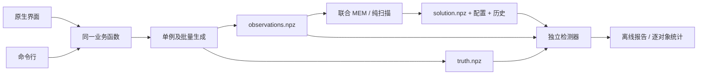

# 设计与本地代码审查

审查日期：2026-10-20（America/Los_Angeles）。此包是新增的软件交付目录；原研究数据、实验实现、远程任务及冻结协议保留原样。

## 1. 本地实际有哪些可用代码

| 本地目录/文件 | 用途 | 首版采用方式 |
|---|---|---|
| `../20260812-zzm 代码/create_2D.py` | 早期二维模拟器 | 审查来源；发现一格延迟偏移，不能直接套上界面发布 |
| `../20260812-zzm 代码/main_2D_auto.py`、`MEM_2D_auto.py`、`mem01.py` | 早期联合优化脚本 | 保留历史；存在硬编码误差、全局随机种子、固定维度和混合目标函数等问题 |
| `../blr_mem_1d_week1/src/blr_mem/mem.py`、`optimizer.py`、`experiment.py` | 固定/重建连续谱条件下的正 MEM、误差传播和实验 | 有完整实验价值；数学模型与首版联合反演分开标注 |
| `../blr_mem_1d_week1/src/blr_mem/memecho.py` | 一维连续谱、传递函数、背景联合反演 | 复用目标函数、解析导数、参数化和插值；首版明确使用固定默认图像 |
| `../20260825-CNN 2D 测试/FULL_2D_EXPERIMENT/src2d/mem2d.py` | 二维完整联合 MEM | 复用目标函数和坐标块求解；只增加最终默认图像的诊断输出 |
| `../2D_R4_GENERALIZATION/` 至 `../2D_R7_FAST_2D/` | 后续泛化与机器学习实验 | 本版不接入网络，也不把这些目录的结果当作当前程序包测试 |
| `../GPT_REVIEW_PACKAGES/BLR_AGN_GPT_20261021/` | 既有实验审核副本 | 仅帮助识别证据边界；当前软件验证不改写既有实验结论 |

复用文件的来源和原始 SHA-256 见 `provenance.json`。原一维测试 34 项在本次会话中重新执行；新包另有独立测试。测试收据位于本地 `evidence/`，不默认加入公开源码归档。

## 2. 已确认的问题

### 生成与优化的一格延迟差异

早期生成器把切片 `c[j-M+100:j+100]` 反转后与图像相乘。由于切片右端不包含在内，标作 `tau=0` 的像素实际使用 `C(t-1)`。优化器使用 `M-arange(M)`，对应 `C(t-tau)`。

独立单位脉冲试验中，只打开标作零延迟的一个像素；生成结果与 `C(t-1)` 完全一致，与 `C(t)` 的最大绝对差为 `0.1600183847815182`。这是软件索引错误，会造成系统性的一个采样步长偏移。

新生成器直接按实际坐标查询 `t_L-tau`，独立检测器逐延迟累加，不复用生产矩阵。测试还使用非单位 `d_tau`，防止“网格刚好为 1”掩盖漏乘积分权重的问题。

### 一维尺度不均衡与假停滞

连续谱背景、传递函数像素和发射线背景的数量级不同，直接在对数坐标使用 L-BFGS-B 可能在目标函数变化很小时停下，仍留有较大的原坐标一阶残差。

首版增加固定的对角尺度预处理：`log p = log p_initial + D z`，`D` 由初值处的 Gauss–Newton 对角尺度计算。仍调用原目标函数和解析导数，链式导数为 `dF/dz = D dF/dlog p`。没有更改噪声、正则化强度、默认图像或数据。导数测试和目标函数等值测试验证了坐标变换。

L-BFGS-B 的算法参考 [Zhu et al. (1997)](REFERENCES.md#bound-constrained-optimization)，数值库参考 [Virtanen et al. (2020)](REFERENCES.md#scientific-computing)。

这会改变优化轨迹，因此本包不是历史优化器轨迹的逐位复现。源代码原样保留；新包的数值变化明确记录在结果中。

### 成功标志含义不一致

原二维 `success` 汇总了历史所有优化块。早期一个块达到预算、后面继续优化并满足最后的一阶条件时，它仍可能为假；反过来，库函数因为 `ftol` 停止也不能保证一阶残差足够小。

检测器独立重算最终梯度和原有 TEST 条件，保留历史失败标志。最后固定默认图像下的数值收敛、浮动默认图像是否稳定分别报告。没有通过增加容差把失败改成通过。

## 3. 数学约定和单位

响应函数的回声映射框架见 [Blandford & McKee (1982)](REFERENCES.md#reverberation-mapping)；联合最大熵、正相对熵与默认图像的背景见 [Horne (1994)](REFERENCES.md#maximum-entropy-echo-mapping)。下列离散化、单位和目标因子以当前实现为准。

统一前向关系：

\[
 L_k(t_i)=L_{0,k}+\sum_j\Psi_{kj}[C(t_i-\tau_j)-C_0]\Delta\tau.
\]

`k` 为速度通道；一维只有一个通道。`time/day`，`velocity/km s^-1`。当前二维图表示每个速度 bin 内已经积分后的响应，`Psi` 单位为 `day^-1 per velocity bin`，不是每单位速度的连续密度。生成真值满足 `sum(Psi)*d_tau=1`。沿速度直接求和得到积分时延响应；若另行转换为连续速度密度，则需除以各速度 bin 的宽度。

原始幅度与单位和归一化形状均输出。检测器计算形状 NMSE 前另做归一化，不会修改优化器保存的原始图。

一维固定默认图像联合目标：

\[
 F_1=\tfrac12(\chi_C^2+\chi_L^2)-\alpha(S_C+W S_\Psi),\quad Q_1=-F_1.
\]

一维熵包含相应时间步长。背景为正，当前一维目标未给背景另加熵项。

二维既有联合目标：

\[
 F_2=\chi_C^2+\chi_L^2-\alpha_\Psi S_\Psi-\alpha_C S_C-\alpha_{L0}S_{L0},\quad Q_2=-F_2.
\]

二维熵采用原实现的像素求和。整体因子与网格约定会改变超参数的尺度。禁止将两种维度或不同网格的 alpha 数字当作可直接比较的物理量。

连续谱由有限长高斯幂律傅里叶过程生成，同时随机化振幅和相位，方法背景见 [Timmer & König (1995)](REFERENCES.md#power-law-light-curves)。本包还按样本标准差归一化。它只是当前合成验证模型；尚未加入长序列裁剪、红噪声泄漏、复杂标定误差或完整 AGN 物理模型。

## 4. 程序结构

源代码的职责边界：

- `config.py`：默认值、参数校验和支持范围。
- `data.py`：生成、观测格式、批次身份和续跑。
- `solver.py`、`scaled_1d.py`：既有数值实现的适配与尺度预处理。
- `detector.py`：独立前向累加、目标函数、梯度与模拟指标。
- `scan.py`：完整枚举和逐点收据。
- `benchmark.py`：计算前冻结验证协议，逐例运行并保留失败。
- `report.py`：图像和离线 HTML。
- `gui.py`、`cli.py`：薄入口，共用业务逻辑。
- `_vendor/`：可追溯的历史实现。

这里以单一职责和少量直接接口落实 SOLID/KISS；以共用内核落实 DRY。没有为本次未要求的机器学习、云服务或插件系统预留抽象层。

## 5. 检测器能回答什么

| 检查 | 能证明 | 无法单独证明 |
|---|---|---|
| 文件 SHA、数组身份 | 文件与输入对应，内容未发生未记录变化 | 算法或科学正确 |
| 形状、单位、时间覆盖 | 满足当前数据接口和卷积支撑条件 | 数据来源可靠 |
| 独立前向重算 | 图、连续谱、背景与导出的预测一致 | 反问题唯一 |
| 独立梯度与 TEST | 最后默认图像对应的数值一阶条件 | 全局最优、真实结构恢复 |
| 默认图像变化量 | 给定浮动默认迭代预算的稳定程度 | 正则化偏差消失 |
| 模拟恢复指标 | 对这批合成真值的恢复表现 | 真实 AGN 适用性 |

无噪声数据不自动填充虚假误差。没有真值的真实观测可按接口提供 `observations.npz` 和元数据；当前首版没有经过真实观测验证，也没有导入向导。

已知真值的恢复检验与物理解读的文献背景见 [Mangham et al. (2019)](REFERENCES.md#controlled-recovery-tests)。该论文为 MEMEcho/CARAMEL 盲测；本包的合成验证使用独立协议，没有复现其基准。真实观测下的 MEMEcho 研究可参阅 [Horne et al. (2021)](REFERENCES.md#observational-context)。

## 6. 默认值和纯扫描

默认配置均在 `1D/mem_defaults.json` 和 `2D/mem_defaults.json` 展开。它们是此包的小网格示例起点，没有依据本次测试真值选择最优超参数。

一维保留 `max_iterations=1200`，尺度预处理后将 `ftol` 显式设为 `1e-15`；二维内层 coordinate cycles 从历史缺省 20 增到 80，其他预算和目标保持可见。上述变化属于新软件版本的数值方案，不覆盖冻结实验协议。原容差保持在独立检测中使用。

纯扫描只枚举配置、求解、检测和落盘，不读取真值、不隐藏边界点，也不自动输出一个“最佳参数”。将来若加入自动选择，需要另行定义基于观测的交叉验证或验证集选择协议；测试真值只允许用于最终评价。

## 7. 下一步优先级

先完成 Windows 二进制、真实界面操作和许可证核验，再修补验证矩阵暴露的数值失败；每个改动使用新协议目录重新验证，并保留前版失败。随后才是更丰富的采样、连续谱模型、真实观测导入及不确定性分析。机器学习接入使用同一观测接口和独立检测器，不能把训练集上的拟合或本次软件测试当成泛化证据。
