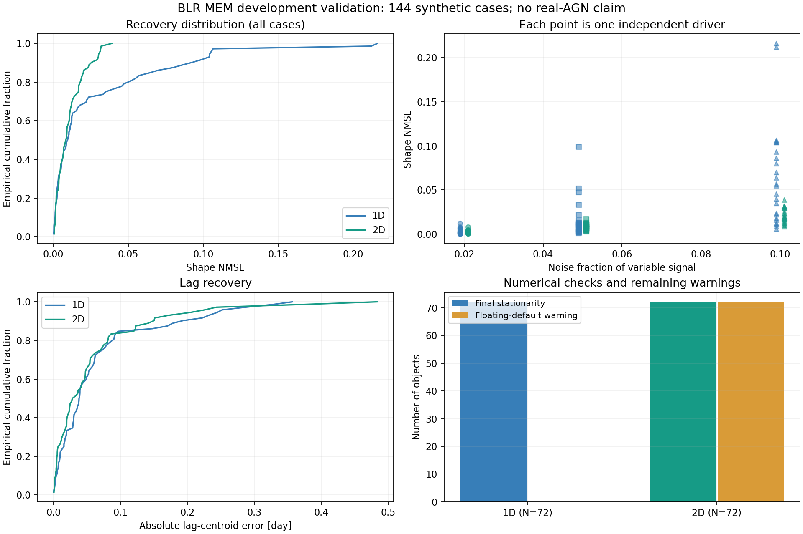

# 实际验证结果与限制

验证日期：2026-10-20（America/Los_Angeles）。环境为 macOS arm64、Python 3.13.5、NumPy 2.3.4、SciPy 1.15.3、pandas 2.2.3、Matplotlib 3.10.0。macOS Apple Silicon 应用已构建，并通过两维原生界面流程和命令行检查；Windows、Intel Mac 和真实 AGN 仍未验收。

可以支持的结论是：当前小网格、指定合成模型下，一维/二维生成、联合 MEM、独立检测和统计流程可运行，最终固定默认图像下的一阶条件通过。二维浮动默认图像的稳定性仍有未通过警告，不能据此宣称整个科学软件已完成正式发布验收。

## 自动测试

| 项目 | 实际执行结果 | 覆盖范围 |
|---|---|---|
| 原一维项目测试 | 34/34 通过 | 既有一维数值实现及实验；原目录未修改 |
| 新程序包测试 | 最新 60/60 通过 | 原 32 项基础上增加扫描续跑错误、JSON/类型边界、BOM、中文摘要，以及有/无真值的两维报告检查 |
| Ruff | 通过 | 新编写的源文件、测试和工具；保留来源实现原貌 |
| 两例命令行检查 | 2/2 最终数值条件通过 | 一维/二维软件流程；二维默认图像警告保留 |
| Python 分发检查 | wheel 安装与 2 例运行通过；sdist 离线重建 wheel 通过 | 隔离目录使用已存在的科学依赖；未修改全局环境，不代表 Windows 安装验收 |
| macOS 原生应用 | arm64 .app 构建、签名完整性、GUI/CLI 两维操作链通过 | 中文及空格输出路径、批量、纯扫描、报告；M 系列本机，未公证，未在无 Python 的干净 Mac 复测 |

独立单位脉冲测试复核了早期二维生成器的一格偏移：标为零延迟的像素实际使用前一天连续谱。新包使用真实时间坐标查询，测试覆盖非单位积分步长。另一个负测试在修改预测值、同时更新文件 SHA 的情况下，检测器仍可通过独立前向模型发现不一致。

优化器真值隔离测试禁止打开或校验 `truth.npz`，实际求解只读取观测。扫描测试枚举完整笛卡尔积、不输出最优选择、不读取模拟真值，并能把数值未通过传播为命令行返回码 2。

## 144 对象主验证

计算前保存协议：`evidence/validation_20261021_v1/protocol.json`。目录名中的 `20261021` 和相应随机种子为既有实验标识，保留原样；它们不表示实际执行日期。一维、二维分别采用 3 种形态、噪声幅度 2%/5%/10%、整期谱线缺失 0%/15%、每个条件 4 个独立驱动种子，各 72 个对象。每个对象的 driver 实现不同；由于部分形态固定，共有 75 个不同响应图，不能把 144 说成 144 种独立物理形态。

一维延迟网格 0–15 day、步长 1 day，共 16 像素；二维 9 个速度通道×16 个延迟像素。监测时长 60 day，cadence 1 day，连续谱有最大延迟对应的前置历史。它们是开发用小网格，不能代替原有 25×100 或更高分辨率实验的验证。

完整逐对象表：[validation_per_case.csv](validation_per_case.csv)。结构化汇总：[validation_summary.json](validation_summary.json)。全部 144 个有限结果进入统计，没有按收敛/误差删除对象。

| 指标 | 一维 | 二维 |
|---|---:|---:|
| 计算完成/计划 | 72/72 | 72/72 |
| 独立前向一致性通过 | 72/72 | 72/72 |
| 最终固定默认图像的一阶条件通过 | 72/72 | 72/72 |
| 形状 NMSE 均值 | 0.0287063 | 0.0108047 |
| 形状 NMSE 中位数 | 0.0097061 | 0.0086010 |
| 形状 NMSE P90 | 0.0923774 | 0.0254833 |
| 时延重心绝对误差均值/day | 0.0665153 | 0.0594451 |
| 最大时延重心绝对误差/day | 0.357031 | 0.484096 |
| 最大形状 NMSE | 0.216162 | 0.0390504 |
| 单对象求解时间中位数/s | 0.02790 | 0.86397 |
| 浮动默认图像稳定性警告 | 不适用固定默认模式 | **72/72** |
| 优化历史有中间失败标志 | 0/72 | **64/72** |

两列使用不同图像族和参数数目，不能据此宣布二维算法优于一维算法。求解时间排除了读取、绘图、界面和报告，不是 Windows EXE 或完整端到端速度测试。

与单位面积平坦响应的配对形状 NMSE 差均值分别为 −0.46619、−0.65079。对象 bootstrap 95% 区间分别为 [−0.49962,−0.43206] 和 [−0.66946,−0.63267]。这个对照仅说明相对于低信息量平坦图的恢复能力；没有执行 MEMECHO/PyROA/BRAINS 等正式程序的同数据比较，也不能把这两个区间解释为真实目标后验可信区间。

## 已有解的独立复核

没有重算主验证。使用现有数据和解重新校验全部 144 个对象的文件 SHA、真值前向关系、恢复前向关系、梯度、状态及恢复指标；与保存的逐对象指标在 `rtol=atol=1e-12` 内一致。

最大生成前向相对误差 `2.5633e-16`，最大结果前向相对误差 `2.5896e-16`。复核记录为 `evidence/validation_reaudit.json`。核心配置、生成器、求解器、独立检测器、尺度预处理和来源数值模块的 SHA 与计算时一致。之后仅补充了 GUI/CLI 的警告传播和打包 EXE 的来源元数据；不修改主验证的科学输入、目标、指标或数值解。

## 浮动默认图像的测试后诊断

三个对象选择规则先写入单独协议：取二维三种形态在主矩阵中的首个对象，即 case 72、96、120；复用已存在的 6 轮结果，另外计算 12、24 轮。它们是**测试后数值诊断**，没有覆盖或替换主结果，也没有用于重新挑选 alpha。

| 对象 | 6 轮默认图像变化 | 24 轮默认图像变化 | 24 轮图相对 6 轮的变化 |
|---|---:|---:|---:|
| 72，Gaussian | 0.313528 | 0.020901 | 0.2449% |
| 96，倾斜 Gaussian | 0.495899 | 0.036390 | 0.3618% |
| 120，双斑块 | 0.504393 | 0.021696 | 0.1888% |

全部满足最后固定默认图像的一阶条件，但 24 轮后仍超过原先列出的默认图像稳定阈值 0.002。分块复算显示，这三个对象的最大变化来自响应图默认值；连续谱和背景默认值已经小得多。

图本身的变化很小，说明“默认图像对数变化大”和“响应图大幅改变”不能混用。样本只有三个，而且在测试后选定诊断方案，当前证据不足以取消稳定性警告或修改原阈值。后续需要进一步检查低响应像素、默认图像定义和数值预算，并用独立方案验证。

## macOS 应用、界面和 Windows 的实际状态

原生 Tk 界面包含生成、MEM/扫描、检测/报告和批量验证四页。早期普通执行环境出现 AppKit/XPC 崩溃或事件处理卡住；改在可访问桌面的环境使用真实 `mainloop` 后，源码和最终 `.app` 均通过两维生成、MEM、独立检测、报告及错误恢复测试。早期失败记录保留在 `evidence/gui_validation_limit.json`；后续通过收据分别为 `evidence/gui_flow_mainloop_macos.json` 和 `evidence/macos_native_arm64_final/validation.json`。不以导入或语法检查替代这些交互流程。

macOS `.app` 使用 PyInstaller 6.22.3 构建，包含 Python、数值依赖和 Tcl/Tk。冻结程序完成一维/二维两例数值检查、2 例无噪声批量生成、2 点纯扫描和离线报告；清除外部 Python/Tcl 环境变量后仍可运行。251 个 Mach-O 文件的动态库审计没有发现非系统绝对路径依赖。应用经 macOS 原生启动打开；界面像素截图和完整人工视觉验收尚未完成。

产物为 arm64，当前仅在本机 macOS 26.6.2 验证，不能外推为 Intel 或所有旧 macOS 版本通过。使用临时签名并验证完整性，没有 Developer ID 签名或 Apple 公证；未执行无 Python 的干净 Mac 测试。打包、启动和默认输出路径的改动没有改变主验证的科学模型、参数或核心数值代码。

2026-10-21 增加 `0.1.0.dev1` 成品复查。macOS 新版应用再次通过 GUI/CLI 操作链；Windows x64 便携包已经组装，包含原生小型 EXE 启动器、固定版本 CPython 3.13.5、Windows wheels 与 Tcl/Tk。在独立 Wine 11.18 环境中，实际 Windows 二进制通过 20 个操作检查，覆盖两维 GUI/CLI、批量与扫描续跑、报告和错误返回。真实 Windows 10/11、无 Python 干净 Windows 和 Intel Mac 尚未实测；截至该次成品复查，GitHub CI 尚未触发。实际收据见 [Windows 兼容层检查](receipts/windows_wine_validation.json)，分发包内也附平台检查收据。后续云端测试记录与成品检查分别保留，见 [构建与分发](RELEASE_ZH.md)。

本轮没有修改生成器、求解器、尺度预处理、独立检测器或 vendor 数值模块。配置层补充了 JSON 对象/数值类型检查，科学默认配置与 `1D/`、`2D/` 的保存参数一致；60 项测试通过，旧 144 例的恢复指标与状态只读复核一致。扫描调度、界面与报告有软件层变更，因此旧扫描不能直接混用新版源码续跑。

低响应像素诊断覆盖全部 72 个二维旧解：响应低于峰值 1% 的像素比例中位数 24.65%，总响应份额中位数 0.4056%，其均方对数默认变化贡献中位数 84.30%。此为测试后解释，不更改稳定阈值，也不把原 WARN 改成 PASS。协议、逐例表和汇总位于 `evidence/improvement_review_20261021/readonly_analysis_final/`。

## 当前不能声称的结论

程序在上述合成分布外的稳定性、真实 AGN 恢复质量、完整后验/误差覆盖率、不同物理模型的可辨识性、更细二维网格表现、Windows 性能、与成熟程序的公平优劣均尚未建立。当前未完成作者和开源许可证核验，不应直接视为可公开发布的正式版本。
